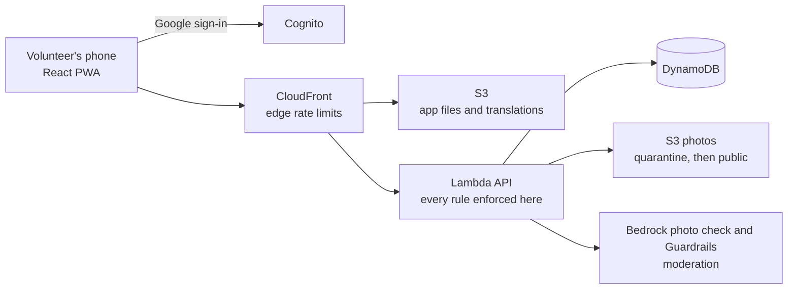

<div align="center">


**The stray-cat feeding map that checks someone really showed up.**

[](https://github.com/Bar-2020/silent-whisker/actions/workflows/ci.yml)


</div>

Volunteers pin the spots where stray cats are fed, log every feeding and water refill, flag cats in
danger, and chat. A log counts only when the volunteer's phone is within 50 m of the spot, so the
map shows what really happened, not what people say.

Free and open source. Hebrew first, English second. Israel first. Built by a cat lover.

> [!NOTE]
> Silent Whisker is early. Phase 0 is done: the verification harness and CI are in place. The app
> itself is not built yet, so this page describes what v1 will do. The plan and build order are in
> [docs/PRODUCT.md](docs/PRODUCT.md#build-order).

## Why not a Facebook group?

A group or a shared spreadsheet can list feeding spots. Neither can tell you whether anyone
showed up. Here, a red pin means a spot needs help, and a green pin means a volunteer really was
there.


## What v1 does

| | |
|---|---|
| 🗺️ **Map** | Every feeding spot on an OpenStreetMap map. Pins go green, orange or red by the time since the last verified feeding or water. |
| 🥣 **Feeding and water logs** | Pick a full or partial bowl. No photo needed. Anyone at the spot can report it empty. |
| 🚨 **Alerts** | Flag a cat that is in danger or sick. It stays on the map until someone resolves it. |
| 🐈 **Cats** | Photograph a cat you know at a spot. Others can like and comment. |
| 💬 **Chat** | Small chats per spot or per cat, moderated automatically. |
| 🏥 **Places** | Vets and organisations that help strays, on the same map. |
| 🏙️ **Municipal stations** | Feeding stations that cities already installed, imported from public sources. |
| 📈 **Profile** | Your stats: cats helped, feedings and water given. |
| 🌍 **Hebrew and English** | Hebrew by default, right to left. Every string is translated, none are hardcoded. |

## Privacy and trust

- **Approximate by default.** The map shows a circle of about 300 m, not a pin on someone's door.
  Exact addresses go only to signed-in members, up to 30 lookups a day each.
- **Your location stays yours.** Your phone's position is used once, to check the distance. Only
  the distance, rounded to 10 m, is kept.
- **Moderated before public.** Photos are checked by an AI model on Amazon Bedrock and text by
  Bedrock Guardrails. Nothing is public until it passes, and if the check fails it stays hidden.
- **The server decides.** Every rule is enforced in the backend, never only in the app. See
  [docs/RULES.md](docs/RULES.md).
- **No surprise bills.** Every metered AWS call goes through one function that checks a daily cap.

## Under the hood

Planned architecture:



| Layer | Choice |
|---|---|
| App | React, Vite, TypeScript, react-leaflet, react-i18next, installable PWA |
| Backend | AWS Lambda behind CloudFront, DynamoDB, Cognito, S3 |
| Infrastructure | Terraform, deployed from GitHub Actions on every merge |
| Quality | `npm run verify`: typecheck, Vite+ (Oxlint and Oxfmt), Vitest, fallow audit |

## Roadmap

| Phase | What ships | Status |
|---|---|---|
| 0 | Repo, verification harness and CI | ✅ Done |
| 1 | AWS infrastructure and deploy pipeline, with the daily cost cap | Next |
| 2 | Google sign-in, profile, landing page, Hebrew and English shell, the look of the app | Planned |
| 3 | Map and spots, municipal stations, moderated photo upload | Planned |
| 4 | Feeding and water logs, first-run location screen, the needs-food-and-water layer | Planned |
| 5 | Cats, likes, comments, chat | Planned |
| 6 | Alerts, places, stats, donation link, launch checklist | Planned |

## Develop

Needs Node 22.18 or newer (the current LTS, 24, works). On an older Node, `npm ci` silently skips the
Vite+ binaries and `npm run verify` fails with "Cannot find native binding": upgrade Node and run
`npm ci` again.

```
npm ci
npm run verify   # typecheck, lint, tests, fallow audit
```

Development is spec driven. [docs/](docs/PRODUCT.md) is the source of truth, and
[CLAUDE.md](CLAUDE.md) indexes the rules in `.claude/instructions/`.

| Spec | What it holds |
|---|---|
| [PRODUCT](docs/PRODUCT.md) | What the app is, v1 scope, non-goals, money |
| [RULES](docs/RULES.md) | The numbered rules and where each is enforced |
| [DATA](docs/DATA.md) | Tables and the queries they serve |
| [API](docs/API.md) | Endpoints and static files |
| [SOURCES](docs/SOURCES.md) | Where municipal feeding stations come from |
| [DECISIONS](docs/DECISIONS.md) | Accepted, proposed and open decisions |
| [AWS](docs/AWS.md) | Regions, prices and free-tier facts, with sources |

## Contributing

Every PR runs `npm run verify` in CI. The automatic Claude review (`[R1]`, `[R2]`, ... findings,
checked against CLAUDE.md) is currently disabled. See [.github/workflows/ci.yml](.github/workflows/ci.yml)
and [.github/claude-review-prompt.md](.github/claude-review-prompt.md).

## License

[MIT](LICENSE)

Made with ❤️ by Bar Almog
