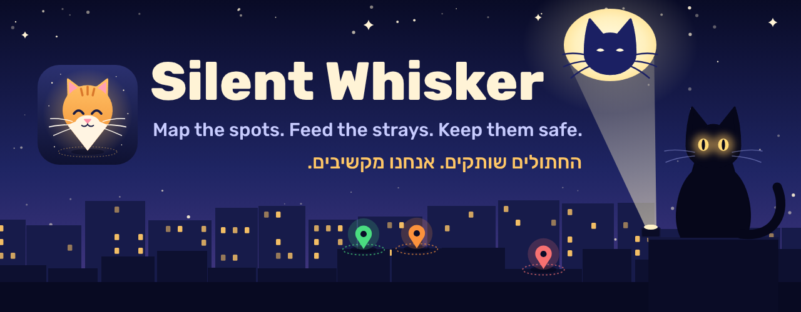
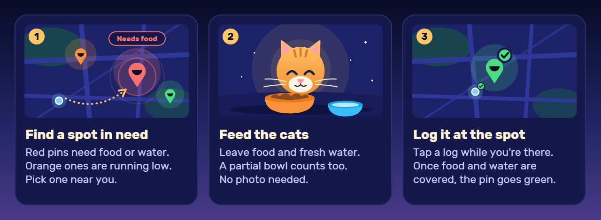
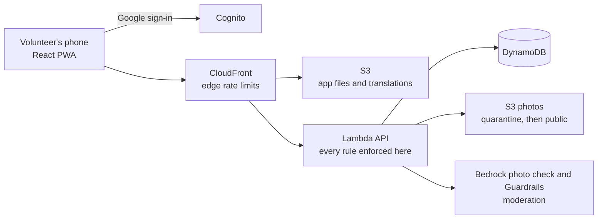

<div align="center">



**The stray-cat feeding map that checks someone really showed up.**

[](https://github.com/Bar-2020/silent-whisker/actions/workflows/ci.yml)


</div>

Volunteers can pin the spots where stray cats are fed, log every feeding and water refill, flag cats in
danger, and chat.

Free and open source. Built by a cat lover.

> [!NOTE]
> Silent Whisker is early. Phases 0 and 1 are done (the verification harness, CI, the AWS
> infrastructure and the deploy pipeline) and phase 2, Google sign-in, the profile and the look of the
> app, is under way. The app screens are not built yet, so this page describes what v1 will do. The plan and build order are in
> [docs/PRODUCT.md](docs/PRODUCT.md#build-order).

## Why not a Facebook group?

A group or a shared spreadsheet can list feeding spots. Neither can tell you whether anyone
showed up. Here, a red pin means a spot needs help, and a green pin means a volunteer really was
there.



## What v1 does

| | |
|---|---|
| 🗺️ **Map** | Every feeding spot is located on the map. Pins go green, orange or red depending on its condition, and a list view shows the spots near you that need a feeding, most urgent first. |
| 🥣 **Feeding and water logs** | Pick a full or partial bowl or report it empty if needed. |
| 🚨 **Alerts** | Flag a cat that is in danger or sick. |
| 🐈 **Cats** | Photograph a cat you love at a spot. Others can like and comment. |
| 💬 **Chat** | Each spot has a chat, moderated automatically. |
| 🏙️ **Municipal stations** | Feeding stations that cities already installed, imported from public sources. |
| 📈 **Profile** | Your stats: cats helped, feedings and water given. |
| 🌍 **Four languages** | Hebrew, English, Arabic and Russian. |

After v1: vets, volunteering events and adoption events on the map, and push notifications.

## Privacy and trust

- **Exact, but shown with care.** City stations and cat alerts are shown to every member. A spot a
  member adds, often by someone's door, is shown only to members within 150 m of it, or while it needs
  food or water. Nothing is shown to people who are not signed in.
- **Your location stays yours.** Your phone's position is used once, to check the distance. Only
  the distance, rounded to 10 m, is kept.
- **Moderated before public.** Photos are checked by an AI model on Amazon Bedrock and text by
  Bedrock Guardrails. Nothing is public until it passes, and if the check fails it stays hidden.
- **The server decides.** Every rule is enforced in the backend, never only in the app. See
  [docs/RULES.md](docs/RULES.md).
- **Yours to delete.** You can remove your own photos, comments and messages at any time, and delete
  your account.
- **No surprise bills.** Every metered AWS call goes through one function that checks per-member limits and a daily circuit breaker.

## Under the hood

Planned architecture:



| Layer | Choice |
|---|---|
| App | React, Vite, TypeScript, react-leaflet, react-i18next; a website the browser can install |
| Backend | AWS Lambda behind CloudFront, DynamoDB, Cognito, S3 |
| Infrastructure | Terraform, deployed from GitHub Actions on every merge |
| Quality | `npm run verify`: typecheck, Vite+ (Oxlint and Oxfmt), Vitest, fallow |

## Roadmap

| Phase | What ships | Status |
|---|---|---|
| 0 | Repo, verification harness and CI | ✅ Done |
| 1 | AWS infrastructure and deploy pipeline, with the daily cost cap | ✅ Done |
| 2 | Google sign-in, sign-up form, profile, landing page, four-language shell, the look of the app | In progress |
| 3 | Map and spots, municipal stations, moderated photo upload | Planned |
| 4 | Feeding and water logs, first-run location screen, the needs-food-and-water layer | Planned |
| 5 | Cats, likes, comments, chat | Planned |
| 6 | Alerts, stats, donation link, launch checklist | Planned |

## Develop

Needs Node 22.18 or newer (the current LTS, 24, works). On an older Node, `npm ci` silently skips the
Vite+ binaries and `npm run verify` fails with "Cannot find native binding": upgrade Node and run
`npm ci` again.

```
npm ci
npm run verify   # typecheck, lint, tests, fallow
```

Development is spec driven. [docs/](docs/PRODUCT.md) is the source of truth, and
[CLAUDE.md](CLAUDE.md) indexes the rules in `.claude/instructions/`.

| Folder | What it holds |
|---|---|
| `frontend/` | The web app: React, Vite, the Hebrew and English strings |
| `backend/` | The Lambda handlers that enforce every rule |
| `infra/` | Terraform, see [infra/README.md](infra/README.md) |
| `shared/` | What more than one of them reads, such as the limits in `shared/constants/` |

| Spec | What it holds |
|---|---|
| [PRODUCT](docs/PRODUCT.md) | What the app is, v1 scope, non-goals, money |
| [RULES](docs/RULES.md) | The numbered rules and where each is enforced |
| [DATA](docs/DATA.md) | Tables and the queries they serve |
| [API](docs/API.md) | Endpoints and static files |
| [SOURCES](docs/SOURCES.md) | Where municipal feeding stations come from |
| [DECISIONS](docs/DECISIONS.md) | Accepted, proposed and open decisions |
| [AWS](docs/AWS.md) | Regions, prices and free-tier facts, with sources |

## Contributing

Every PR runs the code checks and the Terraform checks in CI, as two jobs (`npm run verify` runs
both locally). The automatic Claude review (`[R1]`, `[R2]`, ... findings,
checked against CLAUDE.md) is currently disabled. See [.github/workflows/ci.yml](.github/workflows/ci.yml)
and [.github/claude-review-prompt.md](.github/claude-review-prompt.md).

## License

[MIT](LICENSE)

Made with ❤️ by Bar Almog
